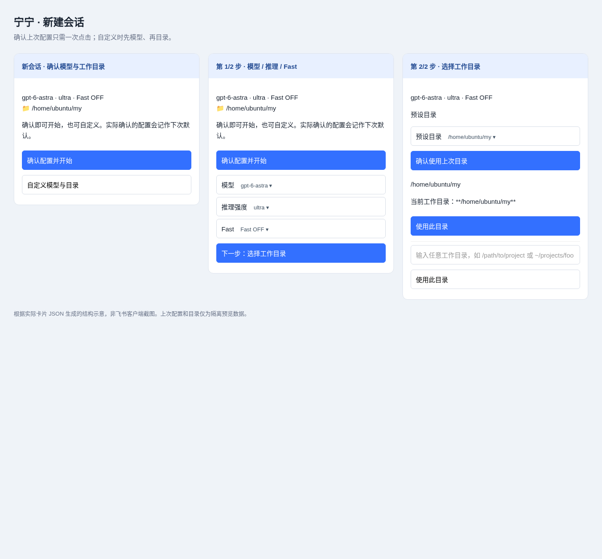

# 宁宁新会话确认

启用 `requireWorkingDirSelection` 的 Codex App 机器人，新建话题会先确认模型、推理强度、Fast 和工作目录，再启动运行器。

- 有上次目录时，首卡展示完整配置，点击「确认配置并开始」一次确认即可开工。
- 点击「自定义模型与目录」可调整模型、推理和 Fast，下一步提供上次目录、最近 5 个目录、预设目录、仓库及自定义路径。
- 首次没有可用上次目录时，直接显示模型选项，再选择目录。
- 每次仍需明确确认；原始任务和附件在选择期间保留。已确认配置按机器人持久保存，关闭或失效卡片不能再次启动会话。
- 模型列表和默认值来自该机器人 CODEX_HOME 的真实能力及配置。首次宁宁默认为 GPT-6 Astra / ultra / Fast OFF；之后沿用该机器人上次实际确认的配置。其他机器人不受此配置影响。

预设目录可通过 `/config set workingDirPresets /home/ubuntu/my,/media/ubuntu/数据目录` 配置。多个路径用逗号或换行分隔，保留路径内空格；不存在、不可读或重复别名会被过滤。最近目录仅来自本机器人会话。

示意根据实际卡片 JSON 生成，非飞书客户端实拍。

验证：新会话流程、单击确认、跨机器人隔离、无效目录、旧卡片、权限、重试、模型切换兼容性、配置持久化与既有仓库选择回归测试；`tsc` 与部署门禁。

## 原生 Codex 会话转发

VS Code / CLI 原生主会话的自动话题，开头使用首次用户输入原文，保留换行与空格；「原会话转发 · 会话ID」标明答复来源。子代理和自动发现的 fork 不创建话题，同一个会话在多个库的副本不重复建话题。已有明确绑定的隔离测试 fork 保留其绑定。

自动扫描只转发，不提交模型输入。只有真人在对应话题追问时，才向该话题绑定的同一会话投递一次原文；消息 ID 去重，已提交但结果不确定的输入不会自动重发。Botmux 自己创建的会话继续由原 Hook 处理，并显示「本话题会话 · 会话ID」，不会再次进入原生会话转发链路。
